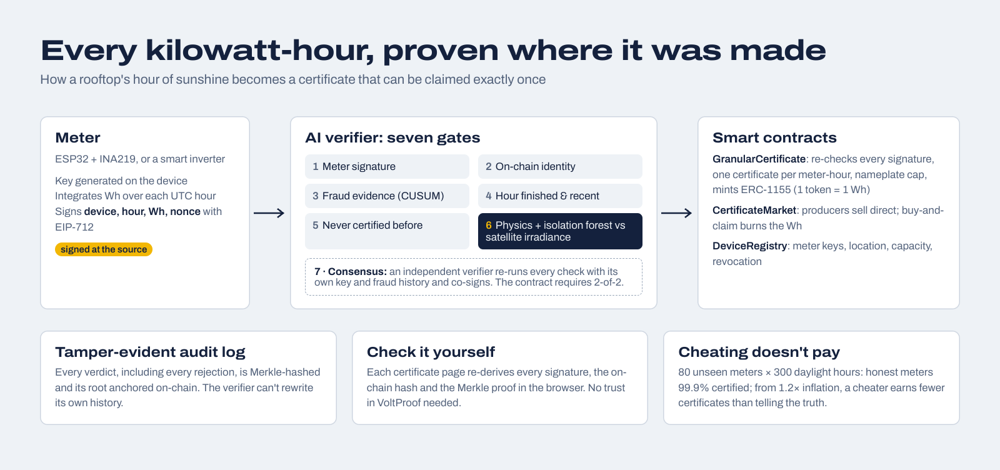

# VoltProof

**Hourly solar certificates that prove the energy was real.**

Rooftop meters sign each hour of solar output with their own key. An AI verifier checks every
claim against satellite irradiance for that exact place and hour. Only then does a smart
contract mint a certificate, and each kilowatt-hour can be claimed exactly once.

> **Track:** Renewable Energy & Energy Trading: renewable certificate tracking, peer-to-peer
> energy trading, tokenized incentives for clean energy.
> IEEE ClimateChain Global Hackathon 2026.
>
> **▶ Live demo:** `https://<your-github-user>.github.io/voltproof/`. It runs in your browser,
> nothing to install. **Run the full stack:** `./demo.sh`.



---

## The problem

Renewable energy certificates are how a company proves the electricity it used was clean. Today
they have three problems:

1. **Small producers are locked out.** Registries are built for utility-scale plants. A household,
   school or farm co-op with a 5 kW rooftop can't afford metering audits and registry fees, so the
   clean energy it produces never enters the market. India alone is adding rooftop solar by the
   millions of homes.
2. **Annual certificates hide the real picture.** Buying a year's worth of certificates lets a
   company claim solar power at midnight. Credible decarbonisation needs *hourly* matching, which
   is far harder to verify.
3. **Blockchain alone doesn't fix trust.** Putting a meter reading on-chain proves someone wrote a
   number down, not that the number is true. This is the *oracle problem*, and most "tokenised
   energy" projects ignore it.

## The solution

VoltProof makes every certificate carry its own evidence:

| Layer | What it proves | How |
|---|---|---|
| **Meter signature** | This exact meter measured this exact energy in this exact hour | ESP32 meter signs an EIP-712 reading with a key generated on the device |
| **On-chain identity** | The meter is real, registered and not revoked | `DeviceRegistry` contract with nameplate capacity and location |
| **Physics** | The claim is physically possible | Solar geometry: zero after sunset, never above clear-sky output for that site and hour |
| **AI verification** | The claim is plausible given the actual weather | Expected output from independent irradiance (Open-Meteo), cloud-aware tolerance, isolation-forest anomaly detection, the meter's own history |
| **M-of-N consensus** | No single verifier can mint on its own | A second, independent verifier re-runs every check with its own key and fraud history; the contract requires `attestationThreshold` distinct verifier signatures (2-of-2 in the demo) |
| **Sequential fraud detection** | The meter isn't cheating a little every hour | CUSUM over each meter's standardised over-claims; suspends persistent over-reporters |
| **Smart contract** | Both signatures are valid; the hour was never certified; energy ≤ nameplate | `GranularCertificate` re-checks everything on-chain and mints ERC-1155 tokens (1 token = 1 Wh) |
| **Retirement** | Nobody else can claim the same Wh | Claiming burns the tokens and records the beneficiary forever; buyers get a printable claim statement and a JSON evidence bundle for Scope 2 reporting |
| **Audit log** | The verifier can't quietly rewrite its decisions | Every verdict, including rejections, goes into a Merkle tree whose root is anchored on-chain |

Anyone can open a certificate page and **re-run every check in their own browser**: signature
recovery, the on-chain hash, the verifier's role, and the Merkle proof. Nothing depends on trusting
VoltProof.

## Results: cheating doesn't pay

The verifier was evaluated on **80 meters it never saw in training**, each run for **300 daylight
hours** alongside identical "twins" that over-report every reading by a fixed factor
(`python -m verifier.evaluate`):

| Meter reports | Hours certified | Meters suspended | Daylight hours until suspended | Certified energy vs. honest twin |
|---|---|---|---|---|
| **The truth** | **99.9%** | **0%** | never | **1.00×** |
| 1.1× the truth | 99.0% | 1% | 166 | 1.09× |
| 1.2× the truth | 70.3% | 48% | 107 | 0.81× |
| 1.35× the truth | 10.8% | 100% | 29 | 0.12× |
| 1.5× the truth | 3.4% | 100% | 13 | 0.04× |
| 2× the truth | 0.5% | 100% | 5 | 0.01× |

- **Honest meters:** 99.9% of hours certified; zero honest meters suspended.
- **Night-time claims:** 100% rejected.
- **Full-sun claims under heavy cloud:** 92% rejected.
- **From 1.2× upward, a cheater earns *fewer* certificates than if it told the truth.** Lying is
  economically irrational.
- **Honest limitation:** inflation below about 10% sits inside the natural disagreement between a
  satellite and a single rooftop, and gains at most about 9%. That residual is bounded by periodic
  physical audits and by keeping the meter key in tamper-resistant hardware.

The evaluation uses a synthetic, physically modelled weather field so it can run offline and be
reproduced. The live verifier uses real Open-Meteo data whenever it's reachable, and every verdict
records which source it used.

## Architecture

```
 ┌──────────────┐  EIP-712 signed reading   ┌───────────────────────────┐  attestation + tx  ┌──────────────────────────┐
 │ Meter        │ ────────────────────────▶ │ AI verifier (FastAPI)     │ ─────────────────▶ │ GranularCertificate      │
 │ ESP32+INA219 │  device, hour, Wh, nonce  │ 1 signature  2 identity   │                    │ re-checks both sigs,     │
 │ or simulator │                           │ 3 risk  4 time  5 unique  │                    │ uniqueness, nameplate    │
 └──────────────┘                           │ 6 physics + AI ─ Open-Meteo│                   │ → mints ERC-1155 (Wh)    │
                                            │ Merkle audit log ─────────┼── anchor root ───▶ │ AuditBatch               │
                                            └───────────────────────────┘                    └────────────┬─────────────┘
                                                                                                          │
 ┌────────────────────────────────────────────┐   buy / buy-and-retire   ┌──────────────────────────┐     │
 │ Web app (Next.js + viem)                   │ ───────────────────────▶ │ CertificateMarket (P2P)  │ ◀───┘
 │ network · attack lab · market · ledger ·   │                          │ escrow → pay producer    │
 │ certificate provenance + in-browser checks │ ◀── reads chain directly │ retire() burns for good  │
 └────────────────────────────────────────────┘                          └──────────────────────────┘
```

| Folder | What it is |
|---|---|
| `contracts/` | Solidity 0.8.24 + OpenZeppelin 5: `DeviceRegistry`, `GranularCertificate` (with M-of-N issuance), `CertificateMarket`. 27 Hardhat tests covering every attack path. |
| `verifier/` | Python FastAPI service: the 7-gate pipeline, physics + ML model, CUSUM, SQLite verdict store, Merkle audit log, evaluation harness. |
| `vpcore/` | Shared physics (solar position, Haurwitz clear-sky, Erbs decomposition, plane-of-array transposition, NOCT temperature), weather providers, EIP-712. |
| `simulator/` | 12-meter fleet across India (one deliberately dishonest), backfill / live modes, Attack Lab scenarios, producer listing and buyer agents. |
| `firmware/` | ESP32 + INA219 meter firmware. Its C crypto core is tested bit-for-bit against the Python/Solidity implementation. |
| `web/` | Next.js 14 app reading the chain directly with viem. `npm run build:demo` builds the static live demo, with the verifier ported to TypeScript (`lib/demo/`). |
| `tests/` | 18 pytest unit tests: physics, EIP-712, Merkle proofs, model decisions, CUSUM. |

## Run it

Requirements: Node 18+, Python 3.11+.

```bash
./demo.sh
```

The script runs every step: it starts a local chain, deploys and registers the fleet, trains and
starts the verifier, and replays 72 hours of meter data. It then lists certificates, makes a few
claims and opens **http://localhost:3000**. The first run takes a few minutes for installs and
model training.

Then try the **Attack lab**: send an honest reading and watch it become a certificate, then try
inflating it, faking sunshine on a cloudy hour, tampering in transit, forging the meter or
replaying an old reading. Each one is stopped by a different check.

Manual steps, if you prefer:

```bash
python3 -m venv .venv && . .venv/bin/activate && pip install -r requirements.txt
cd contracts && npm install --legacy-peer-deps && npx hardhat test && npx hardhat node   # terminal 1
python -m simulator init                                                                 # terminal 2
(cd contracts && npx hardhat run scripts/deploy.js --network localhost)
uvicorn verifier.app:app --port 8000                                                     # terminal 3
python -m simulator backfill --hours 72 && python -m simulator market && python -m simulator buy-demo
# (demo.sh also starts a second, independent verifier on :8001 and wires them as 2-of-2)
cd web && npm install && npm run dev                                                     # terminal 4
```

### Polygon Amoy testnet

```bash
cd contracts
DEPLOYER_KEY=0x… VERIFIER_ADDRESS=0x… npx hardhat run scripts/deploy.js --network amoy
VERIFIER_KEY=0x… DEPLOYMENT=deployments/80002.json DEMO_MODE=0 uvicorn verifier.app:app --port 8000
```

In the web app, leave `NEXT_PUBLIC_DEMO_BUYER_KEY` unset and buyers connect their own wallet.

### Live demo (static, no backend)

The demo site is the same app running from a snapshot of a real local run. Certificates,
signatures, Merkle proofs and anchored roots come straight from that run. In the Attack lab,
readings and attestations are really EIP-712 signed and recovered in the browser. They are
scored by a TypeScript port of the verifier that matches the Python model on 2,000 of 2,000
test cases. Only the final mint is simulated, and the site says so in a banner.

```bash
./demo.sh                                 # in one terminal, then in another:
python scripts/export_snapshot.py         # → web/public/demo/snapshot.json + forest.bin
cd web && npm run build:demo              # → web/demo-site/ (static)
```

**GitHub Pages:** push to GitHub, then go to Settings → Pages → Source: *GitHub Actions*. The
`demo.yml` workflow publishes to `https://<user>.github.io/<repo>/` on every push.
**Vercel:** import the repo with root directory `web`, build command `npm run build:demo`,
output directory `demo-site`, and environment variable `NEXT_PUBLIC_STATIC_DEMO=1`.

### Tests

```bash
cd contracts && npx hardhat test          # 27 contract tests, incl. M-of-N
python -m pytest -q                       # 18 verifier unit tests
python firmware/test/test_firmware.py     # firmware crypto vs. reference implementation
python scripts/parity_cases.py /tmp/p.json && (cd web && npx tsx scripts/parity.ts /tmp/p.json)   # browser model = Python model
python -m verifier.evaluate               # model evaluation (writes eval/results.json)
```

All suites run in GitHub Actions on every push (`.github/workflows/ci.yml`).

## Threat model

| Attack | Defence | What's left |
|---|---|---|
| Owner inflates readings | Physics + AI score; CUSUM suspension; nameplate cap in the contract | < ~10% inflation hides in weather noise (≤ 9% gain); bounded by physical audits |
| Reading altered in transit | EIP-712 signature over device, hour, energy, nonce | — |
| Attacker impersonates a meter | Signer must equal the registered key; revocation on-chain | Key extraction: secure boot, flash encryption, ATECC608 |
| Same hour certified twice | One certificate per meter-hour; strictly increasing nonce, enforced on-chain | — |
| Same energy claimed twice | Retirement burns tokens permanently | Off-chain double selling (e.g. also as a utility REC) needs registry integration |
| Verifier compromised | M-of-N: the contract requires distinct verifier signatures (2-of-2 in the demo); it still checks meter signature, uniqueness and nameplate; every verdict Merkle-anchored | All M verifiers colluding: raise M with verifiers that have different incentives (DISCOMs, auditors, buyers) |
| Relayer steals certificates | Tokens always mint to the registered producer | — |
| Malleable signatures | OpenZeppelin ECDSA requires low-s; firmware and verifier normalise | — |
| Verifier spam / DoS | Cheap signature check first, chain checks before weather lookups | Needs per-device rate limits |

## Scaling and adoption

- **Cheap to join:** a ₹1,500 ESP32 + INA219 retrofit, or firmware in the inverter or smart meter
  a household already has. Many inverters already log hourly output; only signing is new.
- **Cheap to run:** one certificate per meter-hour. On Polygon a mint costs a fraction of a cent.
  The verifier scores a reading in under a millisecond.
- **Fits existing standards:** the hourly Wh granularity follows emerging granular-certificate
  practice for 24/7 carbon-free energy. Retirements carry beneficiary and purpose fields for
  GHG Protocol Scope 2 / ISO 14064 reporting.
- **Decentralises verification:** any party can run a verifier with `VERIFIER_ROLE`, and the
  contract already requires signatures from M of N independent verifiers. Raising M is one
  governance call as DISCOMs, auditors or buyers join.
- **Who uses it:** rooftop households and housing societies, schools and campuses, MSMEs, farm
  co-ops (sellers); companies and institutions with hourly clean-energy targets (buyers);
  regulators and auditors (the public ledger).

## Design notes

- Under-reporting is penalised gently and over-reporting hard: inflation is where fraud pays,
  while soiling, shading and faults only hurt the producer.
- The physics tolerance is uncertainty-aware: tight under clear skies, where satellite irradiance is
  accurate, and wide under broken cloud, where it isn't. This is what lets honest meters pass at
  99.9% without letting cheaters through.
- A meter's "normal" is capped at what a healthy array achieves, so a cheater can't train the
  model into accepting a higher baseline by inflating from day one.
